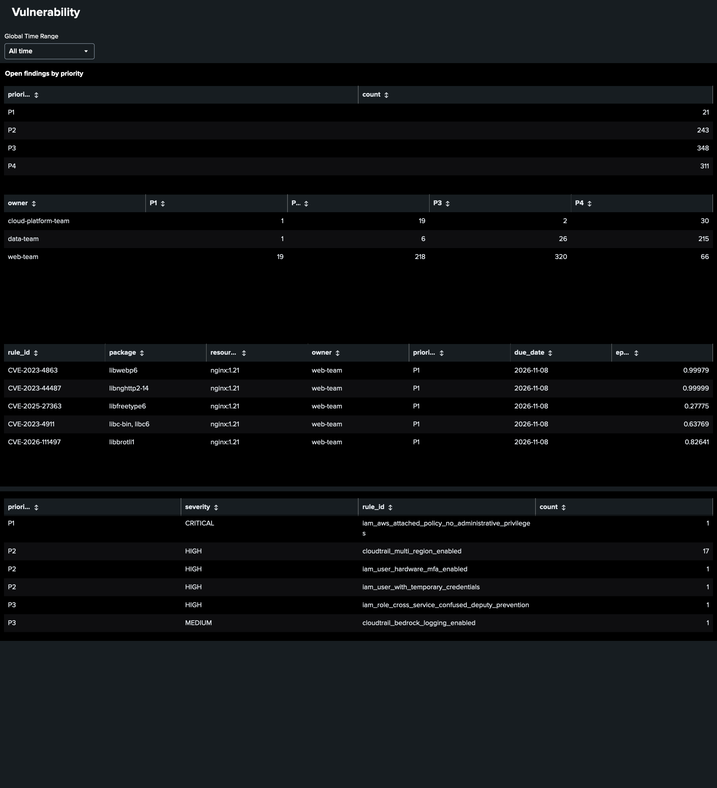

# vulntriage

A small security-operations pipeline that turns raw scanner output into prioritized,
ticketed and auditable work:

```
Trivy (container CVEs) ─┐
                        ├─> normalize ─> enrich (EPSS, CISA KEV) ─> context (owner, exposure,
Prowler (AWS posture) ──┘     ATT&CK, suppressions) ─> score (P1–P4 + SLA) ─> tickets (Jira / GitHub) + Splunk (HEC) ─> report + audit evidence
```

**Why:** scanners produce thousands of findings, and CVSS alone says how *bad* a
vulnerability could be, not how *likely* it is to be exploited or whether it matters here.
This pipeline combines severity, exploit likelihood, active exploitation and business
context into a priority with an SLA, and records the reason for every decision.

## What it does

| Step | Detail |
| --- | --- |
| Parse | Trivy JSON (container/host CVEs) and Prowler JSON-OCSF (AWS misconfigurations) into one schema |
| Enrich | EPSS (probability of exploitation in 30 days, from FIRST) and CISA's Known Exploited Vulnerabilities catalog |
| Context | Asset owner, environment and internet exposure (`config/assets.yaml`); MITRE ATT&CK mapping for cloud misconfigurations |
| Suppress | Verified false positives and accepted risks, each with reason, owner and **expiry** (`config/suppressions.yaml`) |
| Score | Rule-based, explainable points to P1–P4 and an SLA due date (`config/policy.yaml`) |
| Ticket | **Jira Cloud** (or GitHub Issues), de-duplicated by a stable fingerprint |
| SIEM | Every finding sent to **Splunk** through the HTTP Event Collector, with SLA dashboards |
| Report | `out/report.md`, `out/findings.json`, `out/compliance_evidence.csv` (PASS and FAIL per control, for audits) |

### Scoring rules

| Rule | Points |
| --- | --- |
| Severity: critical / high / medium / low (CVSS for CVEs, scanner severity for misconfigurations) | 4 / 3 / 2 / 1 |
| Internet-facing asset | +1 |
| Misconfiguration exposing identities or credentials (ATT&CK T1078, T1552) | +1 |
| Misconfiguration removing logging or detection (ATT&CK T1562) | +1 |
| EPSS ≥ 0.10 | +1 |
| EPSS < 0.01 on an internal asset | −1 |
| On CISA KEV | forced to P1 |

5+ points = P1 (7 days), 4 = P2 (30), 3 = P3 (90), 2 or less = P4 (180).

**Tuning from real data:** the first run on two real images produced 1,446 findings and 67 P1s,
which no team can act on. Three changes followed: a vulnerability now needs a sign of real-world
exploitation (CISA KEV, or EPSS ≥ 0.10) to be P1, otherwise it is capped at P2
(`p1_requires_exploit_signal` in `config/policy.yaml`); the same CVE in several packages built from
one source (for example `curl` and `libcurl4`) is one finding; and `--group-by-image` opens one
"rebuild" ticket per image, since most findings came from an end-of-life base image.
The AWS scan showed the same pattern: 34 CloudTrail failures were one missing multi-region trail
reported per region, so a check failing on many resources or regions also becomes one ticket.
It also showed two scoring gaps, now fixed: an attached AdministratorAccess policy (critical)
scored only P2 because the ATT&CK keyword map missed it, and a missing audit trail scored P3
although it hides every other incident (logging gaps now add a point, ATT&CK T1562).

Example from the sample data: bzip2 CVE-2019-12900 has CVSS 9.8, but it sits on an internal
batch worker with a very low EPSS, so it lands at P3. Log4j CVE-2021-44228 on an
internet-facing API is on CISA KEV, so it is P1 with a 7-day SLA.

## Quick start (sample data, no accounts needed)

```bash
python -m venv .venv && source .venv/bin/activate
pip install -r requirements.txt
python -m pytest -q
python -m vulntriage.cli --offline
cat out/report.md
```

The files in `samples/` are **illustrative**. EPSS values there are placeholders.

## Run on real data

```bash
# 1. Container scan (install Trivy first: https://trivy.dev)
mkdir -p scans
trivy image --format json -o scans/trivy-nginx.json nginx:1.21
trivy image --format json -o scans/trivy-python.json python:3.9-slim-bullseye

# 2. AWS posture scan (in AWS CloudShell, read-only)
pip install prowler
prowler aws --services s3 iam ec2 cloudtrail --output-formats json-ocsf --output-directory scans

# 3. Add your images/accounts to config/assets.yaml, then run with live EPSS + KEV
python -m vulntriage.cli --trivy "scans/trivy-*.json" --prowler "scans/*.ocsf.json"

# 4. Tickets (needs a GitHub token with Issues read/write on the repo)
export GITHUB_TOKEN=...
python -m vulntriage.cli --trivy "scans/trivy-*.json" --prowler "scans/*.ocsf.json" \
  --repo YOUR_USER/vuln-tickets --create-tickets --min-priority P2

# 4b. Or Jira Cloud tickets (free plan; API token from id.atlassian.com)
export JIRA_EMAIL=you@example.com JIRA_API_TOKEN=...
python -m vulntriage.cli --trivy "scans/trivy-*.json" --prowler "scans/*.ocsf.json" \
  --jira-url https://YOUR_SITE.atlassian.net --jira-project SEC --create-tickets

# 4c. Send every finding to Splunk (local Docker lab; see "Splunk lab" below)
export SPLUNK_HEC_TOKEN=...
python -m vulntriage.cli --trivy "scans/trivy-*.json" --prowler "scans/*.ocsf.json" \
  --splunk-hec-url https://localhost:8088 --splunk-insecure

```

Scanner output formats change between versions. If a field comes back empty, inspect a
record (`jq '.[0]' scans/*.ocsf.json`) and adjust the paths in `vulntriage/parsers.py`.

## Splunk lab (local, free)


Every run re-sends all findings, so the panels keep only the latest event per finding (`dedup fingerprint`).

```bash
docker run -d --name splunk -p 8000:8000 -p 8088:8088 \
  -e SPLUNK_START_ARGS=--accept-license \
  -e SPLUNK_GENERAL_TERMS=--accept-sgt-current-at-splunk-com \
  -e SPLUNK_PASSWORD='ChangeMe-Str0ng!' \
  -e SPLUNK_HEC_TOKEN=11111111-2222-3333-4444-555555555555 \
  splunk/splunk:latest
```

Open http://localhost:8000 (user `admin`), wait for startup (a few minutes), then set
`SPLUNK_HEC_TOKEN` to the same value. On Apple Silicon add `--platform linux/amd64`.
`--splunk-insecure` is only for this local lab (self-signed certificate).
Dashboard searches are in `detections/vulntriage_dashboards.spl`.

## Also in this repo

- `detections/cloudtrail_hunts.spl`: five hypothesis-driven Splunk hunts on CloudTrail, each mapped to MITRE ATT&CK
- `docs/runbook-public-s3-bucket.md`: an SOP for a publicly exposed bucket (triage, contain, investigate, recover)
- `docs/postmortem-template.md`: a blameless postmortem template with a tabletop example

## Limitations and next steps

- Asset context is a static YAML file; production would pull it from a CMDB or cloud tags.
- Tickets are created but not auto-closed; next step is closing tickets when a re-scan no longer finds the issue.
- Reachability analysis (is the vulnerable function actually called?) is manual, recorded as a suppression.
- Next: run on a schedule, auto-close Jira tickets on clean re-scans, and add runtime signals from Falco.

## Author
```bash
Vasudha Padala
Master in Computer Science
University of Southern California
```
